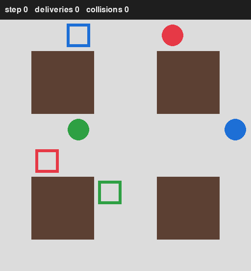
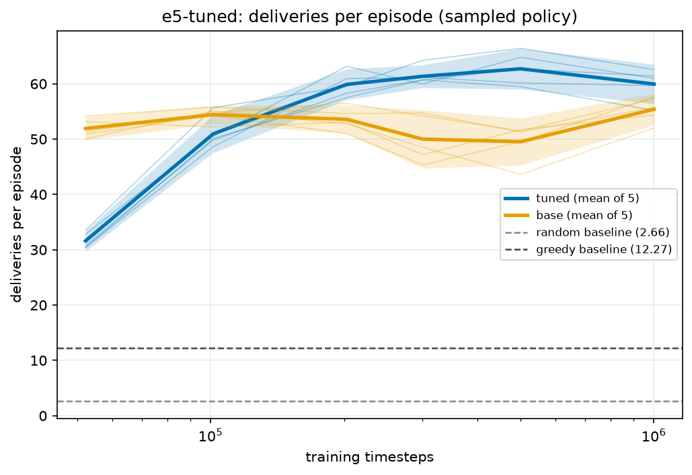
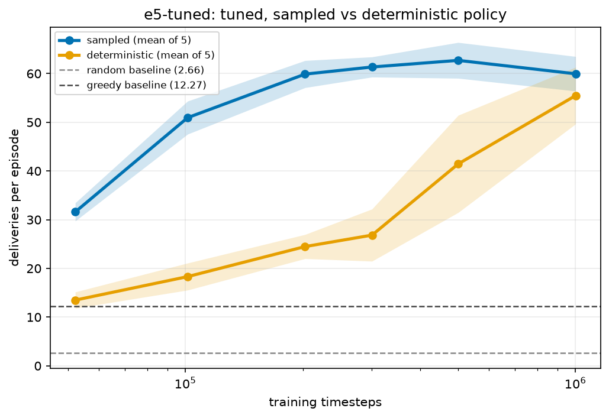
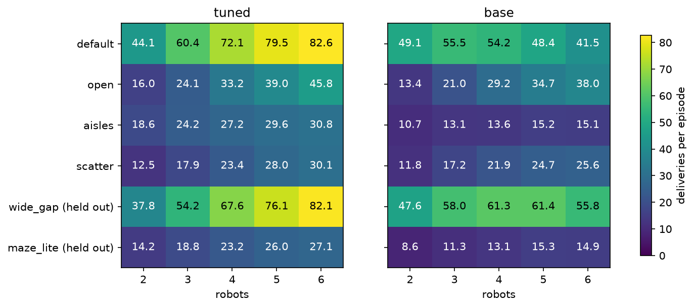

<h1 align="center">Multi-Agent Warehouse</h1>
<p align="center"><b>Three robots, one warehouse, one shared PPO brain. A from-scratch multi-agent RL project: the environment, the baselines, the training pipeline and an honest evaluation.</b></p>

<p align="center">
  <br>
  <sub>The first-version PPO agent (300k steps, `ppo_v1_300k.zip`), 100 steps: 44 deliveries, 20 collisions (evaluation seed 50). Each robot runs the same network.</sub>
</p>

---

## At a Glance

- **The task:** three robots move simultaneously on an 8 x 8 grid. Each one reaches its target item, is
  handed a new target on delivery, and is penalised for bumping into other robots.
- **The learner:** one recurrent PPO network (Stable-Baselines3 / sb3-contrib, an LSTM policy)
  shared by all robots through SuperSuit parameter sharing, trained for 1,000,000 steps (about 35
  minutes on a laptop CPU). The first version was a plain 300,000-step PPO that trained in about 15
  seconds; it is kept as `models/ppo_v1_300k.zip`.
- **The result:** **62.0 deliveries per episode, against 12.7 for a hand-written greedy rule and 2.6
  for random**, with about an eighth of greedy's collisions (51 against 401). Measured over 100
  fixed seeds with shaping off, 95% confidence intervals below.
- **The honesty:** it still collides about 4x more than random, the model was picked from 5 seeds
  and scored on a separate test block, and the [limitations](#what-this-does-and-does-not-show) are
  written down.

## Why I Built This

I wanted to learn multi-agent RL properly, and that meant not starting from a ready-made
environment. A learned policy is only as trustworthy as the world it trains in and the baseline it
is compared against. So I wrote the rules, rewards, observations and renderer myself against the
PettingZoo `ParallelEnv` API, tested them, added two scripted baselines, and only then trained an
agent and measured it against them.

The library is deliberately small (about 1,000 lines, docstrings included) so the whole thing can
be read in one sitting.

## The RL Approach

### Problem formulation

| Piece | Choice | Why it matters for learning |
|---|---|---|
| Setting | Simultaneous-move, partially observable, with individual rewards | Robots act at once and see only their neighbourhood, so coordination has to emerge from local information |
| Observation | `Box(-1, 1, (8,))`: own row and column, offset to target, four blocked flags (wall, shelf or another robot) | Small enough to learn from quickly, yet it contains everything needed to avoid a neighbour |
| Actions | `Discrete(5)`: stay, up, down, left, right | Discrete, so PPO's categorical policy applies directly |
| Reward | +1.0 delivery, -0.01 per step, -0.1 per collision | The step penalty rewards speed and the collision penalty is the only signal about other robots |
| Episode | 200 steps, all robots truncated together | A fixed horizon makes episodes comparable |

### Training pipeline

1. **PPO from Stable-Baselines3** with an `MlpPolicy`. I chose not to re-implement the optimiser:
   the point is to understand and apply it, and to demonstrate the environment.
2. **Parameter sharing with SuperSuit.** The robots are identical, so one network controls all of
   them. SuperSuit turns each robot into one sub-environment of a vectorised env, and 8 copies are
   concatenated. That gives `3 robots x 8 envs = 24` sub-environments, all feeding the same network,
   so every robot's experience improves every robot's behaviour.
3. **Reward shaping, in training only.** The +1 delivery reward is sparse, so a randomly
   wandering robot rarely sees it. I add a potential-based bonus of `+0.02 x (distance to target
   before the step - after)` (Ng et al., 1999). It is on during training and **always off in
   evaluation**, so reported numbers measure the real task and not the training aid.
4. **Stochastic actions at inference.** The trained policy samples from its action distribution
   instead of taking the arg-max. With shared weights and similar observations, deterministic robots
   can mirror each other into a head-on standoff forever; sampling breaks the symmetry. Seeding makes
   each sampled episode reproducible. (The recurrent model largely avoids the collapse: see below.)
5. **A tuned configuration found by experiment.** The shipped model uses a 14-value observation
   (the basic eight plus four robot-neighbour flags and the offset to the nearest robot), an LSTM
   policy, a collision penalty of -0.3 and an entropy bonus of 0.01. Each came from a measured
   comparison, described in [`FINDINGS.md`](docs/multi_agent_warehouse/results/FINDINGS.md).

```bash
pip install -e ".[rl]"
python -m multi_agent_warehouse.train   # the original plain PPO: 300,000 steps, 8 envs, n_steps 128
python -m multi_agent_warehouse.experiment run --name my-run --variants tuned --seeds 1 --steps 1000000
```

The committed model, `models/ppo_multi_agent_warehouse.zip` (7.2 MB), is the `tuned` variant
(training seed 330, 1M steps). It comes with a sidecar, `models/ppo_multi_agent_warehouse.json`,
holding its training config, which `evaluate.py` and `play.py` read to build the matching
observation and policy class. A model without a sidecar is treated as a plain PPO on the basic
observation. The RL dependencies are an optional extra, imported lazily, so the environment and
scripted baselines install without PyTorch.

### Seed policy and experiments

Training seeds are drawn at random from `[0, 1000)` and recorded in each experiment's
`manifest.json` (a fixed seed would let a lucky run pass as a result). Evaluation blocks are drawn
from `[10,000, 2^31)`, so they never overlap training seeds. Every claim compares several seeds,
reports the seed spread, and calls a difference real only if it is more than twice its standard
error. Experiments are resumable and write CSVs and figures:

```bash
python -m multi_agent_warehouse.experiment run --name e5-tuned --variants tuned,base --seeds 5 --steps 1000000
python -m multi_agent_warehouse.experiment plot --name e5-tuned
python -m multi_agent_warehouse.experiment generalise --name e5-tuned --variants tuned,base
python -m multi_agent_warehouse.experiment select --name e5-tuned --variant tuned --committed models/ppo_v1_300k.zip
```

`select` picks the best seed on a random validation block and reports it on a second, disjoint test
block, so the reported model score is not inflated by the choice. The shipped model replaced the
old one only because its test score beat both the old model and `base` by more than the seed
spread.

### Evaluation protocol

Every policy is scored on the same 100 seeded episodes (seeds 1000 to 1099), 3 robots, 200 steps,
shaping off. Using identical seeds makes the comparison paired, and each mean is reported with a
95% confidence interval. Progress is judged by this evaluation and never by the training reward,
which includes the shaping bonus.

## Results

| Policy | Deliveries / episode | Collisions / episode |
|--------|---------------------:|---------------------:|
| random |        2.63 ± 0.34   |        12.80 ± 1.49  |
| greedy |       12.67 ± 2.07   |       401.30 ± 24.24 |
| **Tuned recurrent PPO (shared)** | **61.99 ± 1.37** | **50.90 ± 4.91** |
| *First version: plain PPO, 300k steps (`ppo_v1_300k.zip`)* | *51.07 ± 3.27* | *189.95 ± 20.65* |

- The tuned PPO delivers about **4.9x more than greedy and 24x more than random**, and collides
  about one eighth as often as greedy.
- Greedy has the worst collision count by far. A collision is counted per robot per step, so 200
  steps with 3 robots allows at most 600, and greedy sits at about 400. Its rule only looks at its
  own target and four neighbours, so its robots spend much of the episode blocking each other. That
  is the coordination failure a learned policy should improve on, and the tuned PPO cuts it by
  about 87%.
- Random barely collides because it barely goes anywhere. Collisions on their own are not a
  quality measure, which is why every result reports both columns.

### Hyperparameter experiment: the rollout budget

SuperSuit makes each robot its own sub-environment, and SB3's `n_steps` counts per sub-environment.
With the library default of 2048, one rollout is `2048 x 24 = 49,152` samples, so 300,000 training
steps yield only about 7 policy updates. I measured whether that mattered
(300,000 steps each, 30 evaluation episodes from seed 1000, shaping off):

| `n_steps` / `batch_size` | Training seeds | Deliveries / episode | Collisions / episode |
|---|---|---|---|
| 2048 / 64 (SB3 defaults) | 0 | 41.4 | 35.7 |
| 256 / 256 | 0, 1, 2 | 50.8, 57.2, 49.8 | 189.6, 126.1, 189.6 |
| **128 / 256 (chosen)** | 0, 1, 2 | 54.7, 58.5, 60.1 | 170.9, 136.3, 136.9 |

Smaller rollouts mean more updates from the same data (about 98 instead of 7), and the chosen
setting delivered the most and varied the least across seeds. Every setting beat random by a wide
margin and beat greedy, so the budget was a tuning matter and not a blocker. Note the trade-off:
the default setting delivers less but collides far less (36 versus 137 to 171), a different point on
the speed-versus-safety curve that I did not explore further.

### How the improved model was found

Training improvements were tested one at a time, 5 random seeds each, with a shared evaluation block
(full numbers and caveats in
[`FINDINGS.md`](docs/multi_agent_warehouse/results/FINDINGS.md)):

- **Seed spread is large.** The original single run (51 deliveries) is typical, but across seeds the
  same recipe ranges about 44 to 57.
- **Training much longer helps the plain PPO**: about 51 at 300k, 60.8 at 3M steps.
- **Memory and a richer observation clearly help** (500k steps): an LSTM adds about 10 deliveries
  and the richer observation about 7; together about 12, and fewer collisions.
- **A harsher collision penalty (-0.3) and an entropy bonus (0.01) helped only borderline** (just
  over 2 standard errors), so they are included tentatively. A penalty of -1.0 clearly hurt.
- **Training on random layouts did not help on held-out layouts** and was left out.



The tuned model starts slower but overtakes the plain PPO by about 100k to 200k steps. At the same
1M-step budget it is ahead by 4.6 deliveries (about 2.8 standard errors), with about 3.7x fewer
collisions. The plain PPO was shown to keep improving to 3M steps, so this is an equal-budget
comparison and not a claim to beat a fully trained plain PPO.

The 5 tuned seeds were scored on a separate test block, and the best seed on validation (seed 330:
63.0 deliveries) was chosen. The other four seeds average about 60.5, so a typical run is about 60.

**Sampled versus deterministic.** The plain PPO collapses when it takes the arg-max action (11
deliveries, about the same as greedy). The tuned recurrent policy mostly does not (55 deliveries),
though it still does better with sampling (60). The cause is not diagnosed.



**Generalisation.** Both variants were trained on the default layout with 3 robots only, then
evaluated on every layout and 2 to 6 robots (100 episodes per cell). On two layouts neither had
seen, the tuned model averaged 42.7 deliveries against 34.7 for the plain PPO, and on the default
layout it gets better with more robots while the plain PPO gets worse. The harder held-out layout
(`maze_lite`) stays poor for both (22 and 13).



### What this does and does not show

- **Shown:** on this layout, with 3 robots, a single shared network trained with PPO beats both
  scripted baselines on deliveries and beats greedy on collisions, with confidence intervals that do
  not overlap.
- **Not shown:** strong generalisation. The committed model was trained on one fixed map with 3
  robots. It transfers well to a similar wider-gap map, but remains poor on a maze-like one, and
  training on random layouts did not fix that.
- **Several changes at once.** The tuned model bundles four changes; the experiments support the
  memory and observation changes clearly, and the collision-penalty and entropy changes only
  tentatively. I did not isolate them in the final run.
- **Selection and budget.** The shipped model is the best of 5 seeds picked on validation, so it is a
  few deliveries above the typical run (about 60). It is also the product of 1M steps of an LSTM
  (about 30x slower per step than the plain network); at 3M steps a plain PPO reaches about 61.
- **Open problem:** it still collides about 51 times per episode, about 4x random. I have not
  investigated where those collisions happen, so I make no claim about why.
- **Caveat on the shaping guarantee:** potential-based shaping preserves the optimal policy exactly
  only with no discounting and within one target's lifetime. PPO discounts at 0.99 and targets
  change on delivery, so the guarantee holds only approximately here. Manhattan distance is also a
  sound potential only while shelves cause few detours, which holds on this map.

## Challenges & What I Learned

**A budget problem hidden by a default**
- *Problem:* SB3's default rollout size looked fine, but `n_steps` counts per sub-environment and
  parameter sharing multiplies those.
- *Approach:* Work out the arithmetic before training: 24 sub-environments make the default rollout
  49,152 samples, so 300,000 steps give only about 7 updates. Then test smaller rollouts across
  several seeds rather than trusting one run.
- *Result:* `n_steps = 128` raised deliveries from 41 to about 55 to 60, and taught me to check how
  library defaults interact with my own vectorisation.

**Seeding through a vectorised wrapper**
- *Problem:* `PPO(..., seed=...)` crashes because SuperSuit's `ConcatVecEnv` has no `seed` method.
- *Approach:* Seed Python, NumPy and PyTorch through `set_random_seed`, and seed the environments
  through `ConcatVecEnv.reset(seed=...)`.
- *Result:* The same seed gives identical weights and a different seed gives different weights,
  which is what makes the multi-seed comparison above meaningful.

**A baseline that looks good until you read the second column**
- *Problem:* Greedy beats random on deliveries by a wide margin, but its collision count is huge.
- *Approach:* Report both metrics side by side rather than only the flattering one, and pick the
  evaluation (shaping off, fixed seeds, confidence intervals) before looking at the learned agent.
- *Result:* A concrete, measured weakness for the RL agent to be compared against, and a bar it
  could have failed to clear.

**Simultaneous moves are harder than they look**
- *Problem:* Two robots can target one cell, swap, or be blocked indirectly by a robot that was
  itself blocked.
- *Approach:* Start with the two obvious rules, notice that a blocked robot becomes a stayer and can
  block others, and iterate to a fixed point.
- *Result:* A small pure function with its own tests, and a clear definition of when a robot
  "collided", which the collision penalty and metric both depend on.

**Takeaways:** Most of RL lives in details that never appear in an algorithm diagram: what the
observation hides, which events a reward can see, how defaults interact with vectorisation, and how
seeding determines whether two runs are comparable at all.

## The Environment

| Part | Choice |
|---|---|
| Interface | PettingZoo `ParallelEnv`; all robots act at once |
| Map | One fixed 8 x 8 layout with four 2 x 2 shelf blocks, defined in `config.py` |
| Robots | 1 to 6 (default 3), named `robot_0`, `robot_1`, ... |
| Task | Reach your target; on delivery you immediately get a new one |
| Episode | No terminations; every robot is truncated together at 200 steps |

- **Complete API:** `reset`/`step`/`render`/`close`, per-agent spaces, truncation, `info` dicts,
  strict input validation, and seeded reproducibility from a single `np.random.default_rng`.
- **Physics as a pure function:** `resolve_moves` settles simultaneous moves with two rules (a cell
  two robots want, and a swap). A blocked robot counts as a stayer, so the rules repeat until
  nothing changes. Bumping a shelf or the edge just keeps the robot in place and is not a collision.
- **Testable rendering:** the renderer always draws offscreen and returns an RGB array; the window is
  an optional extra layer, so rendering is tested headless.

A step runs in a fixed order: validate actions, resolve moves, check targets, compute rewards,
advance the clock, then build observations. Observations are built last so a robot that just
delivered already sees its new target.

## Architecture

```
config.py   layout + every tunable number (the only place settings live)
rules.py    resolve_moves(): pure function, no env state
env.py      MultiAgentWarehouseEnv: ParallelEnv built on rules + config
render.py   Renderer: always draws offscreen, returns an RGB array; "human" also blits to a window
agents.py   Policy protocol (reset, act) + RandomPolicy, GreedyPolicy, RLPolicy
train.py    trains the shared PPO policy (optional `rl` extra)
evaluate.py seeded evaluation table with confidence intervals
play.py     live demo with keyboard controls
```

### Key design decisions

| Decision | Alternatives considered | Why I chose this |
|---|---|---|
| `ParallelEnv` | AEC (turn-based) | Robots act simultaneously, and Parallel maps directly onto vectorised training |
| 8-number local observation | Full-grid or windowed image | Small enough to learn from quickly; still contains everything a policy needs to avoid a neighbour |
| One shared network (parameter sharing) | Independent networks per robot; centralised-critic methods (MAPPO, QMIX) | Identical robots, so one network learns from all experience; the simplest multi-agent training that works with single-agent libraries |
| Stable-Baselines3 PPO | Hand-written PPO | The goal is to apply and evaluate PPO, not to write an optimiser |
| Shaping off by default, never in evaluation | Always on | Keeps reported numbers about the task, not the training aid |
| Policies see observations only | Policies read env internals | Keeps scripted and learned policies interchangeable behind one interface |
| Collisions via a pure function | Resolve inside `step` | A pure function is testable on its own and can be reasoned about without env state |
| Settings in one `config.py` | Constants per module | Changing the map or rewards is a one-file edit, and tests derive sizes from `LAYOUT` |

## Getting Started

Requires Python 3.10+.

```bash
git clone https://github.com/Wayne-cyw/multi-agent-warehouse.git
cd multi-agent-warehouse
python -m venv .venv && source .venv/bin/activate
pip install -e ".[dev,rl]"      # drop ",rl" to skip PyTorch (scripted baselines only)
```

```bash
python play.py --policy rl                  # watch the trained PPO agent
python play.py                              # greedy baseline (space pause, R reset, P switch policy, Q quit)
python play.py --policy random --robots 4   # other policy, more robots
python -m multi_agent_warehouse.evaluate    # reproduce the results table (--episodes N changes the sample size)
python -m multi_agent_warehouse.train       # retrain the original plain PPO (writes models/ppo_multi_agent_warehouse.zip and its sidecar)
pytest                                      # run the tests
```

`play.py` falls back to greedy if the model file is missing. The `rl` row in the evaluation table
appears only when the model exists and Stable-Baselines3 is installed.

## Project Structure

```
multi-agent-warehouse/
├── multi_agent_warehouse/
│   ├── config.py     # layout and settings
│   ├── rules.py      # resolve_moves
│   ├── env.py        # the ParallelEnv
│   ├── render.py     # Pygame renderer
│   ├── agents.py     # random, greedy and RL policies
│   ├── train.py      # PPO / recurrent PPO training
│   ├── experiment.py # multi-seed experiments, model selection
│   ├── plots.py      # learning curves and comparison figures
│   └── evaluate.py   # seeded evaluation
├── models/           # trained weights and their config sidecars
├── play.py           # live demo
├── tests/            # one test file per module
└── docs/             # demo GIF, figures, results/FINDINGS.md
```

## Testing & Quality

- 195 tests covering the rules, the environment contract (invalid actions, calls after the episode
  ends, bad robot counts, determinism), the renderer, the demo and the PPO stack (training saves a
  loadable model, the policy acts for every robot). The RL tests skip if the `rl` extra is absent,
  and everything runs headless via `SDL_VIDEODRIVER=dummy`.
- `ruff` (rules `E, F, I, B, UP`, line length 100) and `ruff format --check`.
- Seeded evaluation: identical calls return identical numbers.

## Roadmap

- [x] Environment, rules and rewards
- [x] Pygame renderer and live demo
- [x] Random and greedy baselines with a seeded evaluation and confidence intervals
- [x] Train PPO (Stable-Baselines3) with parameter sharing through SuperSuit, using shaping during training only
- [x] Compare the learned policy against both baselines, and report honestly where it lands
- [x] Improve training with multi-seed experiments (longer training, memory, richer observation, reward and entropy tuning)
- [ ] Analyse where PPO's remaining collisions happen
- [x] Generalise across layouts and robot counts, one level at a time (measured; maze-like layouts are still poor)
