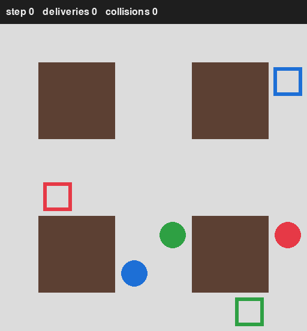

<h1 align="center">Multi-Agent Warehouse</h1>
<p align="center"><b>A from-scratch PettingZoo environment where several robots share one warehouse, built to be a clean testbed for multi-agent reinforcement learning.</b></p>

<p align="center">
  
</p>

---

## Why I Built This

I wanted to learn multi-agent RL by building the part most tutorials skip: the environment. Training
code is only as trustworthy as the world it runs in, so I wrote the rules, rewards, observations and
renderer myself against the PettingZoo `ParallelEnv` API, tested them, and added two scripted
baselines so that any learned policy has something honest to be compared with.

The project is deliberately small (under 900 lines of library code, docstrings included) so the whole thing can be read
in one sitting. Every non-obvious choice is written down with the alternatives I rejected.

## Highlights

- **A complete `ParallelEnv`**: `reset`/`step`/`render`/`close`, per-agent spaces, truncation,
  `info` dicts, strict input validation, and seeded reproducibility from a single
  `np.random.default_rng`.
- **Physics as a pure function**: `resolve_moves` settles simultaneous moves with two rules (same
  cell, swap) iterated to a fixed point, and is tested in isolation from the environment.
- **Reward design with a safety rail**: individual rewards, plus optional potential-based shaping
  that is off by default and never used in evaluation, so reported numbers measure the game and not a
  training aid.
- **Honest baselines**: a random and a greedy policy behind one two-method interface, scored on
  seeded episodes (table below).
- **Tested and linted**: 56 tests (headless Pygame via `SDL_VIDEODRIVER=dummy`), `ruff` check and
  format clean.

## What the baselines show

Mean per episode over 20 fixed seeds (1000 to 1019), 3 robots, 200 steps, shaping off:

| Policy | Deliveries / episode | Collisions / episode |
|--------|---------------------:|---------------------:|
| random |                 2.45 |                 9.90 |
| greedy |                13.50 |               366.90 |

Greedy delivers about 5.5x more than random, but its collision count is the interesting number. A
collision is counted per robot per step, so 200 steps with 3 robots allows at most 600. A value of
roughly 367 suggests that greedy robots spend much of the episode blocking each other, because the
rule only looks at its own target and its four neighbours. That is exactly the failure that
coordination is supposed to fix, and it is the gap a learned policy should be measured against.

## The environment

| Part | Choice |
|---|---|
| Interface | PettingZoo `ParallelEnv`; all robots act at once |
| Map | One fixed 8 x 8 layout with four 2 x 2 shelf blocks, defined in `config.py` |
| Robots | 1 to 6 (default 3), named `robot_0`, `robot_1`, ... |
| Actions | `Discrete(5)`: stay, up, down, left, right |
| Observation | `Box(-1, 1, (8,))`: own row/col, target offset, four blocked flags (wall, shelf or another robot) |
| Task | Reach your target; on delivery you immediately get a new one |
| Rewards | +1.0 delivery, -0.01 every step, -0.1 per collision, optional shaping +0.02 x distance improvement |
| Episode | No terminations; every robot is truncated together at 200 steps |

**Move resolution.** Two rules decide simultaneous moves: a robot moving into a cell that another
robot also wants is blocked, and two robots swapping cells are both blocked. A blocked robot counts
as a stayer, so the rules repeat until nothing changes. Bumping a shelf or the edge just keeps the
robot in place and is not a collision.

## Architecture

```
config.py   layout + every tunable number (the only place settings live)
rules.py    resolve_moves(): pure function, no env state
env.py      MultiAgentWarehouseEnv: ParallelEnv built on rules + config
render.py   Renderer: always draws offscreen, returns an RGB array; "human" also blits to a window
agents.py   Policy protocol (reset, act) + RandomPolicy, GreedyPolicy
evaluate.py seeded evaluation table
play.py     live demo with keyboard controls
```

A step runs in a fixed order: validate actions, resolve moves, check targets, compute rewards,
advance the clock, then build observations. Observations are built last so a robot that just
delivered already sees its new target.

### Key design decisions

| Decision | Alternatives considered | Why I chose this |
|---|---|---|
| `ParallelEnv` | AEC (turn-based) | Robots act simultaneously, and Parallel maps directly onto vectorised training |
| 8-number local observation | Full-grid or windowed image | Small enough to learn from quickly; still contains everything a policy needs to avoid a neighbour |
| Collisions via a pure function | Resolve inside `step` | A pure function is testable on its own and can be reasoned about without env state |
| Shaping off by default, never in evaluation | Always on | Keeps reported numbers about the task, not the training aid |
| Policies see observations only | Policies read env internals | Keeps scripted and learned policies interchangeable |
| Settings in one `config.py` | Constants per module | Changing the map or rewards is a one-file edit, and tests derive sizes from `LAYOUT` |

The full list, with trade-offs, is in the design notes I keep alongside the code.

## Challenges & What I Learned

**Simultaneous moves are harder than they look**
- *Problem:* Two robots can target one cell, swap, or be blocked indirectly by a robot that was itself blocked.
- *Approach:* Start with the two obvious rules, notice that a blocked robot becomes a stayer and can
  block others, and iterate to a fixed point.
- *Result:* A small pure function with its own tests, and a clear definition of when a robot "collided".

**Making a graphical environment testable**
- *Problem:* Pygame wants a window, which breaks CI and quick tests.
- *Approach:* The renderer always draws to an offscreen surface and returns an RGB array; the window
  is an optional extra layer. Pygame is imported lazily and only in the renderer.
- *Result:* Rendering can be tested headless, and `render_mode=None` does nothing at all.

**A baseline that looks good until you read the second column**
- *Problem:* Greedy beats random on deliveries by a wide margin, but its collision count is huge.
- *Approach:* Report both metrics side by side rather than only the flattering one.
- *Result:* A concrete, measured weakness for an RL agent to be compared against.

**Takeaways:** Writing the environment taught me how much of RL lives in details that never appear
in an algorithm diagram: what the observation hides, which events a reward can see, and how seeding
determines whether two runs are comparable at all.

## Getting Started

Requires Python 3.10+.

```bash
git clone https://github.com/Wayne-cyw/multi-agent-warehouse.git
cd multi-agent-warehouse
python -m venv .venv && source .venv/bin/activate
pip install -e ".[dev]"
```

```bash
python play.py                              # live demo (space pause, R reset, P switch policy, Q quit)
python play.py --policy random --robots 4   # other policy, more robots
python -m multi_agent_warehouse.evaluate    # reproduce the table above
pytest                                      # run the tests
```

## Project Structure

```
multi-agent-warehouse/
├── multi_agent_warehouse/
│   ├── config.py     # layout and settings
│   ├── rules.py      # resolve_moves
│   ├── env.py        # the ParallelEnv
│   ├── render.py     # Pygame renderer
│   ├── agents.py     # random and greedy policies
│   └── evaluate.py   # seeded evaluation
├── play.py           # live demo
├── tests/            # one test file per module
└── docs/             # demo GIF
```

## Testing & Quality

- 56 tests covering the rules, the environment contract (invalid actions, calls after the episode
  ends, bad robot counts, determinism), the renderer and the demo, all runnable headless.
- `ruff` (rules `E, F, I, B, UP`, line length 100) and `ruff format --check`.
- Seeded evaluation: identical calls return identical numbers.

## Roadmap

- [x] Environment, rules and rewards
- [x] Pygame renderer and live demo
- [x] Random and greedy baselines with a seeded evaluation
- [ ] Train PPO (Stable-Baselines3) with parameter sharing through SuperSuit, using shaping during training only
- [ ] Compare the learned policy against both baselines, and report honestly where it lands
- [ ] Reduce greedy's deadlocks, or show that learning does
- [ ] Generalise across layouts, one level at a time
