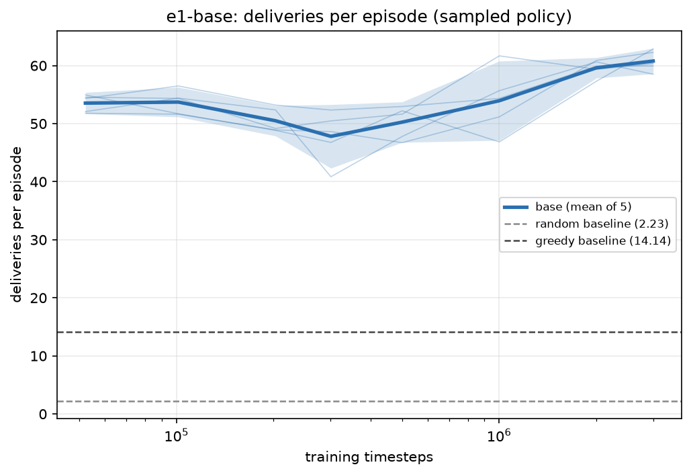
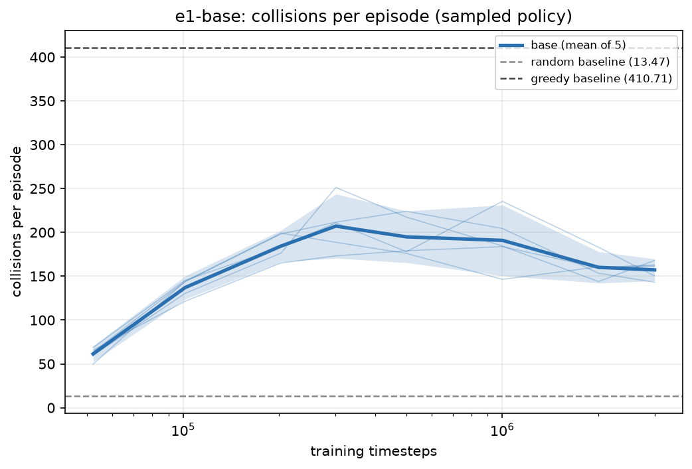
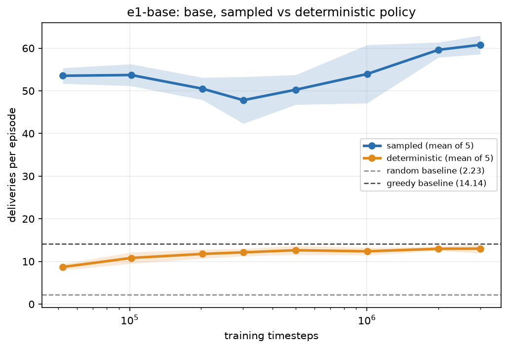
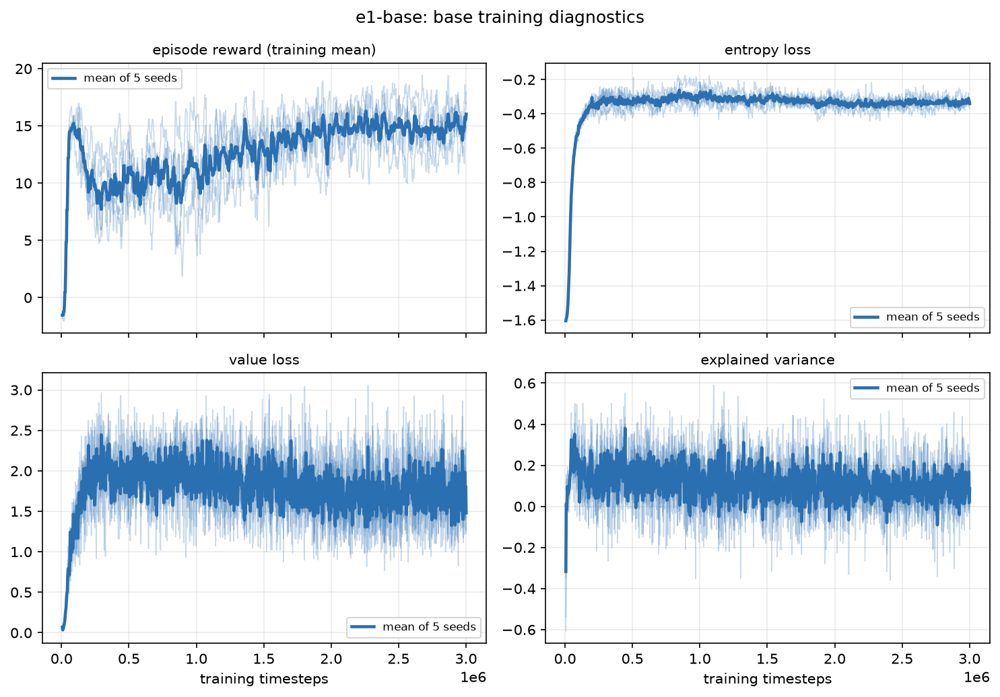

# E1: longer training, sampled versus deterministic

## Question

How does the plain PPO (`base`, with the truncation fix) improve as training gets longer, where does
it stop improving, and what does deterministic evaluation do?

## Setup

- Variant `base` (truncation bootstrapped), 3,000,000 steps, snapshots at 50k, 100k, 200k, 300k, 500k,
  1M, 2M and 3M steps.
- 5 random training seeds (199, 731, 848, 179, 31); evaluation base seed 672125400, 100 episodes.
- Wall clock: 13 min 8 s. The plan allowed up to 3 hours for this run, because training turned out
  to be about 100 times cheaper than first estimated.

```bash
python -m multi_agent_warehouse.experiment run --name e1-base --variants base --seeds 5 --steps 3000000
python -m multi_agent_warehouse.experiment plot --name e1-base
```

## Results

Sampled actions, mean ± seed std:

| Steps | Deliveries | Collisions |
|---|---|---|
| 50k | 53.54 ± 1.48 | 61.40 |
| 100k | 53.71 ± 2.06 | 136.99 |
| 300k | 47.81 ± 4.41 | 207.14 |
| 1M | 53.94 ± 5.50 | 190.89 |
| 2M | 59.62 ± 1.42 | 160.13 |
| 3M | 60.78 ± 1.77 | 157.20 |



- **The curve is not monotone.** The agent jumps to about 54 by 50k steps, declines to a trough of
  47.8 at 300k, then recovers and rises to about 61 by 2M to 3M. The seeds escape the plateau at
  different times (the 1M checkpoint spans 46.9 to 61.7).
- **Saturation.** The gain from 2M to 3M (+1.2) is smaller than the seed spread, so the curve looks
  flat by about 2M. Nothing beyond 3M was run.
- **Collisions rise before they fall.** Over the first 300k steps the agent moves more, not more
  carefully; collisions only fall in the later phase. Even at 3M (157) they are about 12 times random.



### Sampled versus deterministic

Evaluating with the arg-max action instead of sampling is far worse at every checkpoint: about 9 to
13 deliveries (greedy: 13.5 to 14.1) and 255 to 393 collisions.



This is why **sampled evaluation is the headline metric everywhere else**. The gap does not close
with training.



## Did the truncation fix help?

At 300k, `base` (47.81 ± 4.41) against E0's `legacy` (51.12 ± 4.55) differs by -3.3 with an SE of
about 2.9: within noise (and unpaired). Bootstrapping the time limit is correct in principle and
costs nothing, but it was not shown to help on its own. The big gain in E1 comes from training much
longer.

## Caveats

- E0 and E1 use different evaluation blocks, so differences smaller than the seed spread should not
  be read as real.
- The deterministic collapse is observed, not diagnosed. Untested hypothesis: robots that always take
  their most likely action can mirror each other into a head-on standoff.
- The early plateau and dip appear in both variants and in the training reward.

Full detail: [`FINDINGS.md`](../results/FINDINGS.md) sections (b) to (e).
