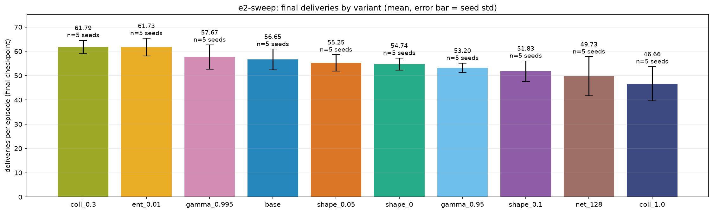
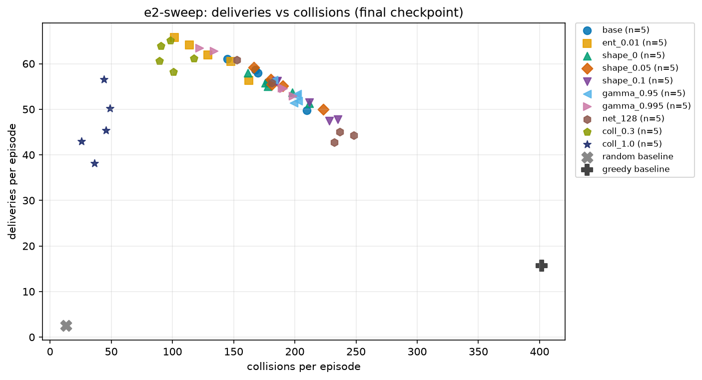

# E2: hyperparameter and reward sweep

## Question

Which training knobs matter? Each of nine one-field changes to `base` is tried on its own.

## Setup

- 10 variants: `base` plus `ent_0.01`, `shape_0`, `shape_0.05`, `shape_0.1`, `gamma_0.95`,
  `gamma_0.995`, `net_128`, `coll_0.3`, `coll_1.0` (see the [variant table](README.md#variants)).
- 5 random training seeds (692, 257, 481, 254, 533), 1M steps, evaluation base seed 184263377 (100
  episodes, shared by all variants). Greedy on this block: 15.71 deliveries; random: 2.49.
- Wall clock: 54 min 17 s for 50 runs.
- `coll_*` and `shape_*` change only the training reward. Evaluation always reports raw collisions
  with shaping off.

```bash
python -m multi_agent_warehouse.experiment run --name e2-sweep \
  --variants base,ent_0.01,shape_0,shape_0.05,shape_0.1,gamma_0.95,gamma_0.995,net_128,coll_0.3,coll_1.0 \
  --seeds 5 --steps 1000000
python -m multi_agent_warehouse.experiment plot --name e2-sweep
```

## Results (sampled, final checkpoint)

| Variant | Deliveries | Collisions | Δ vs base | Δ/SE | Verdict |
|---|---|---|---|---|---|
| coll_0.3 | 61.79 ± 2.74 | 99.31 | +5.14 | 2.27 | helps (tentative) |
| ent_0.01 | 61.73 ± 3.62 | 130.86 | +5.08 | 2.03 | helps (tentative) |
| gamma_0.995 | 57.67 ± 5.01 | 166.84 | +1.02 | 0.35 | no clear effect |
| **base** | 56.65 ± 4.25 | 173.96 | | | |
| shape_0.05 | 55.25 ± 3.34 | 188.41 | -1.40 | -0.58 | no clear effect |
| shape_0 | 54.74 ± 2.50 | 185.03 | -1.91 | -0.87 | no clear effect |
| gamma_0.95 | 53.20 ± 1.95 | 197.55 | -3.45 | -1.65 | no clear effect |
| shape_0.1 | 51.83 ± 4.24 | 209.15 | -4.82 | -1.80 | no clear effect |
| net_128 | 49.73 ± 8.06 | 210.13 | -6.92 | -1.70 | no clear effect |
| coll_1.0 | 46.66 ± 7.05 | 40.06 | -9.99 | -2.71 | **hurts** |





## What it means

- **Collision penalty is the knob that matters.** -0.3 cut collisions from 174 to 99 while
  delivering as much or more. -1.0 cut them to 40 (close to random's 13) but cost about 10
  deliveries: the robots become too timid to move. On the scatter, the collision-heavy variants form
  one curve, with `coll_1.0` at the low-collision end.
- **Entropy 0.01 also helped** (and cut collisions by 43), probably through better exploration. That
  mechanism was not tested.
- **Shaping scale, discount and network size had no clear effect.** Several point estimates are
  negative; that is suggestive at most. `net_128` had the widest seed spread (42.7 to 60.8).

## Caveats

- With 5 seeds and a seed std of 2 to 8 deliveries, only differences of roughly 5 to 6 deliveries
  are detectable.
- Nine comparisons make about 0.7 to 0.9 chance crossings of 2·SE expected. Three crossed. So the
  two "helps" results are tentative and could be luck; the "hurts" result is the most credible.
  They went into the final model anyway ([E5](e5-tuned-model.md)), and E5 did not test them alone.
- The ten-variant learning-curve figure was unreadable at the time (colours repeated), which led to
  a plotting fix. The figures shown here are the readable ones.

Full detail: [`FINDINGS.md`](../results/FINDINGS.md), "E2 sweep".
