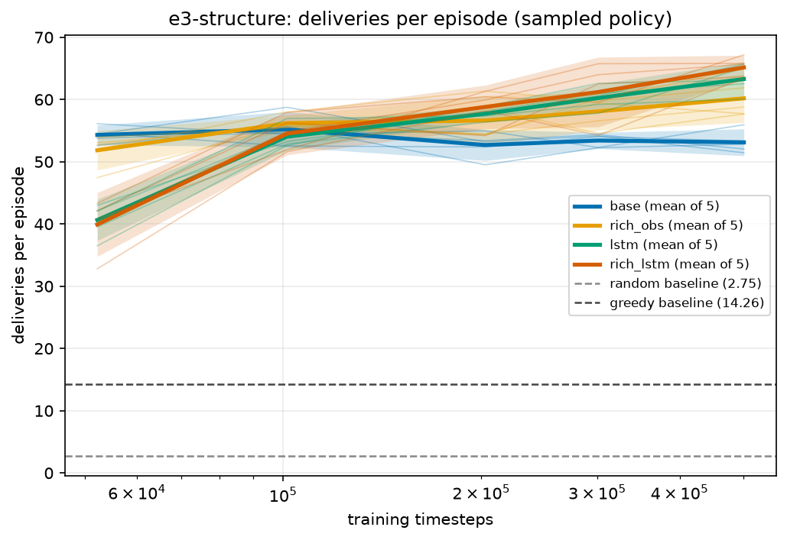
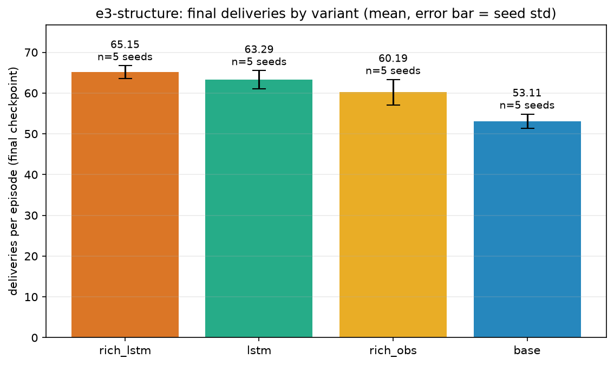
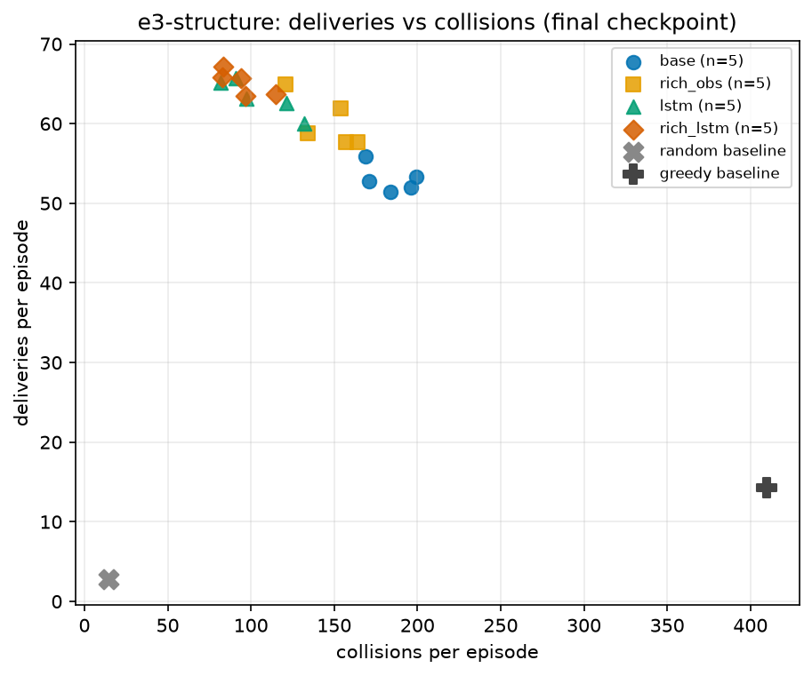

# E3: observation and memory

## Question

The robots see 8 numbers and carry no memory. Do (a) a richer observation and (b) a recurrent
(LSTM) policy help?

## Setup

- `base`, `rich_obs`, `lstm`, `rich_lstm`.
  - **`rich_obs`:** the 14-value observation. The first 8 are unchanged; then 4 flags saying whether
    a robot (not a wall or shelf) blocks each direction, and the offset to the nearest other robot.
  - **`lstm`:** sb3-contrib `RecurrentPPO` with an LSTM policy (one layer of 256 units, separate
    actor and critic LSTMs), so the robot can remember its recent past.
- 5 random training seeds (306, 320, 4, 157, 27); evaluation base seed 2095561372, 100 episodes.
- **500k steps, not 1M.** The LSTM trains about 30 times slower per step (about 550 steps/s against
  about 16,600), because with 200-step episodes and 128-step rollouts almost every minibatch holds an
  episode start, and sb3-contrib then steps the LSTM in a Python loop. 1M steps would have taken
  about 5 hours of training.
- Wall clock: 4 h 35 min, of which about 1 h 48 min was the laptop sleeping (training only paused).

```bash
python -m multi_agent_warehouse.experiment run --name e3-structure \
  --variants base,rich_obs,lstm,rich_lstm --seeds 5 --steps 500000
python -m multi_agent_warehouse.experiment plot --name e3-structure
```

## Results (sampled, 500k steps)

| Variant | Deliveries | Collisions | Δ vs base | Δ/SE | Verdict |
|---|---|---|---|---|---|
| rich_lstm | 65.15 ± 1.57 | 94.28 | +12.03 | 11.48 | helps |
| lstm | 63.29 ± 2.24 | 104.50 | +10.17 | 8.03 | helps |
| rich_obs | 60.19 ± 3.13 | 145.94 | +7.08 | 4.42 | helps |
| **base** | 53.11 ± 1.74 | 183.83 | | | |

Every seed of every non-base variant scored above every `base` seed (lowest 57.7, highest `base`
55.9). The three effects are 4.4 to 11.5 standard errors from zero, far past the threshold.



The recurrent variants start worse (about 40 at 50k against 54) and overtake `base` by about 200k.
`base` is flat from 100k to 500k while the others are still rising.





Both changes also cut collisions, so this is not a trade of deliveries for safety.

### Deterministic evaluation

| Variant | Deterministic deliveries |
|---|---|
| rich_lstm | 37.36 ± 4.89 |
| lstm | 31.88 ± 6.39 |
| rich_obs | 14.39 ± 1.62 |
| base | 12.80 ± 0.73 |

Memory softens the arg-max collapse seen in [E1](e1-longer-training.md) (about 2.5 to 3 times
`base`), but they still only reach 50 to 57% of their own sampled score. The richer observation alone
does not change it. Hypothesis, untested: with memory the arg-max policy can notice it has been
blocked for several steps and change course.

## Caveats

- **500k, not 1M or 3M.** `base` improves late (60.8 at 3M in E1), so the gap may narrow with more
  training.
- **Memory and size are confounded.** `lstm` also has many more parameters. E2's bigger MLP did not
  help, which weakly suggests capacity alone is not the reason.
- **Cost.** About 30 times the wall time per step; at equal wall-clock time `base` could train much
  longer.
- `rich_lstm` over `lstm` is +1.86 (Δ/SE 1.52, no clear difference). That comparison was not
  planned.
- Comparisons with E1 and E2 are unpaired (different evaluation blocks).

Full detail: [`FINDINGS.md`](../results/FINDINGS.md), "E3 structure".
