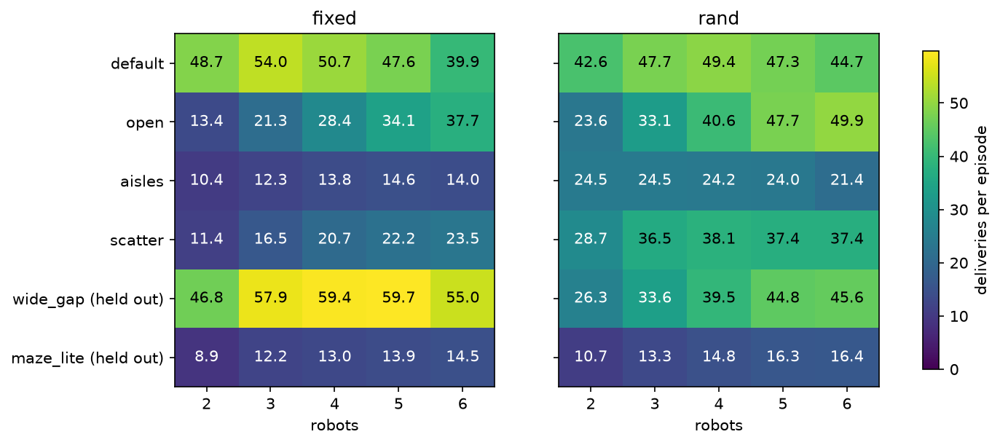
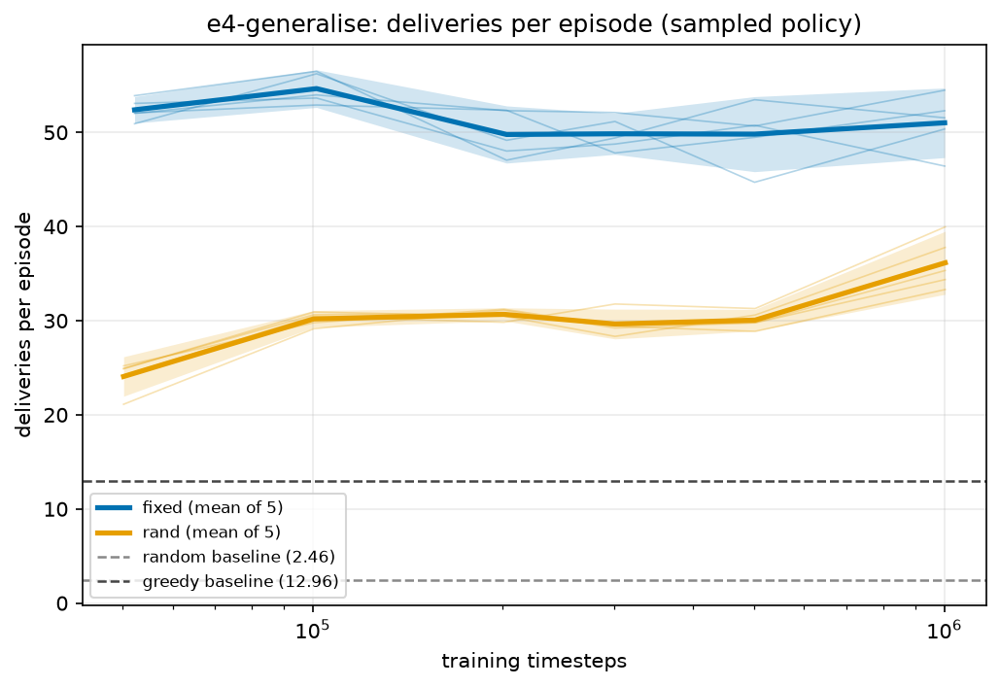
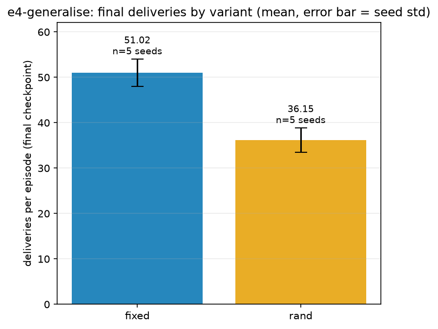

# E4: generalisation to unseen layouts and robot counts

## Question

The committed model was trained on one map with three robots. Does training on many layouts and
robot counts make it work on maps it has never seen?

## Setup

- **Six 8 x 8 layouts.** Training layouts: `default`, `open`, `aisles`, `scatter`. Held-out layouts
  (never trained on): `wide_gap` (the default with wider gaps, so a near-copy) and `maze_lite` (the
  hard one).
- **`fixed`** trains on the default layout with 3 robots (the same as `base`). **`rand`** picks one
  of the four training layouts at every reset and uses 2, 3, 4 or 5 robots across its 8 warehouse
  copies.
- 5 random training seeds (715, 774, 15, 773, 203), 1M steps each, plain PPO.
- Every final model is scored on all 6 layouts and 2 to 6 robots, 100 episodes per cell, shaping off.
  Six robots were never trained on by either variant.

```bash
python -m multi_agent_warehouse.experiment run --name e4-generalise --variants fixed,rand --seeds 5 --steps 1000000
python -m multi_agent_warehouse.experiment generalise --name e4-generalise --variants fixed,rand
python -m multi_agent_warehouse.experiment plot --name e4-generalise
```

## Results (mean deliveries, averaged over robot counts, then over 5 seeds)

| Group | fixed | rand | rand − fixed (SE) |
|---|---|---|---|
| **Held-out layouts** | 34.12 ± 1.66 | 26.14 ± 2.23 | **−7.98 (1.24)** |
| Training layouts | 26.76 ± 1.15 | 36.17 ± 1.77 | +9.41 (0.94) |
| Default layout | 48.18 ± 2.14 | 46.34 ± 0.91 | −1.84 (1.04) |
| `wide_gap` | 55.75 ± 3.36 | 37.97 ± 4.40 | −17.78 (2.48) |
| `maze_lite` | 12.50 ± 0.66 | 14.31 ± 1.11 | +1.82 (0.58) |







## What it means

- **The hypothesis failed.** Randomising layouts did not help on held-out layouts; it hurt by about
  6.4 standard errors. `rand` does win on the layouts it trained on, as expected: `fixed` collapses
  on `aisles` and `scatter` (10 to 24 deliveries), where `rand` gets 21 to 38.
- **`wide_gap` dominates the result.** `fixed` transfers very well there because the layout is almost
  the default one. It is a weak test of generalisation, not proof that `fixed` generalises.
- **`maze_lite` is the real test** and neither copes (12.5 and 14.3, about greedy's level).
- Mixing layouts costs little on the home layout (−1.84, level within noise).

## Caveats

- `rand` spreads the same 1M steps across four layouts and four robot counts, so it sees about a
  quarter of the data per layout. A longer run might narrow or reverse the gap; not tested.
- Only two held-out layouts, one nearly in-distribution.
- The observation contains the absolute cell, so a policy can memorise the default map. A plausible
  reason `fixed` does well only where maps resemble the default; not tested here.
- Not comparable with E1 to E3 numbers (different evaluation block).

Because of this result the layout-randomised variant was left out of the final model ([E5](e5-tuned-model.md)).

Full detail: [`FINDINGS.md`](../results/FINDINGS.md), "E4 generalisation".
