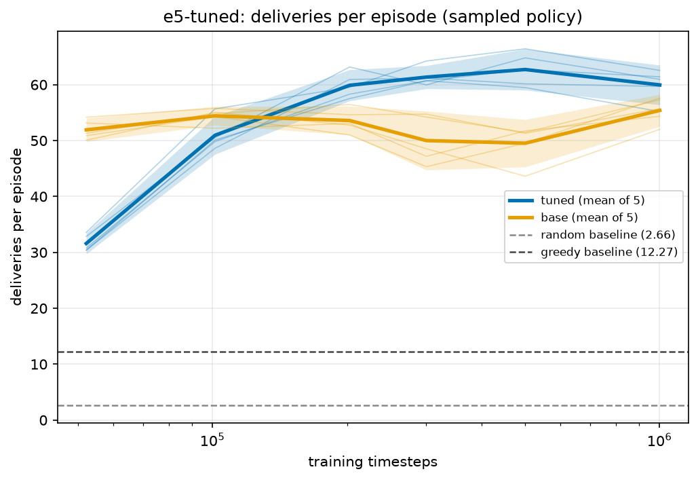
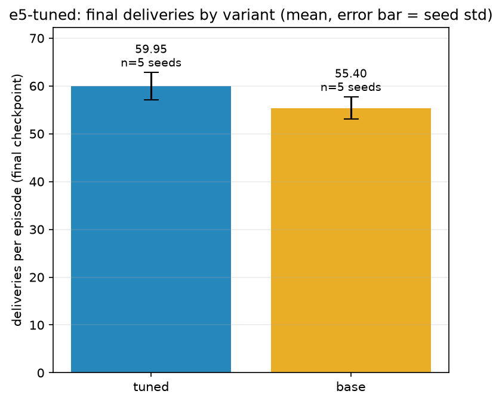
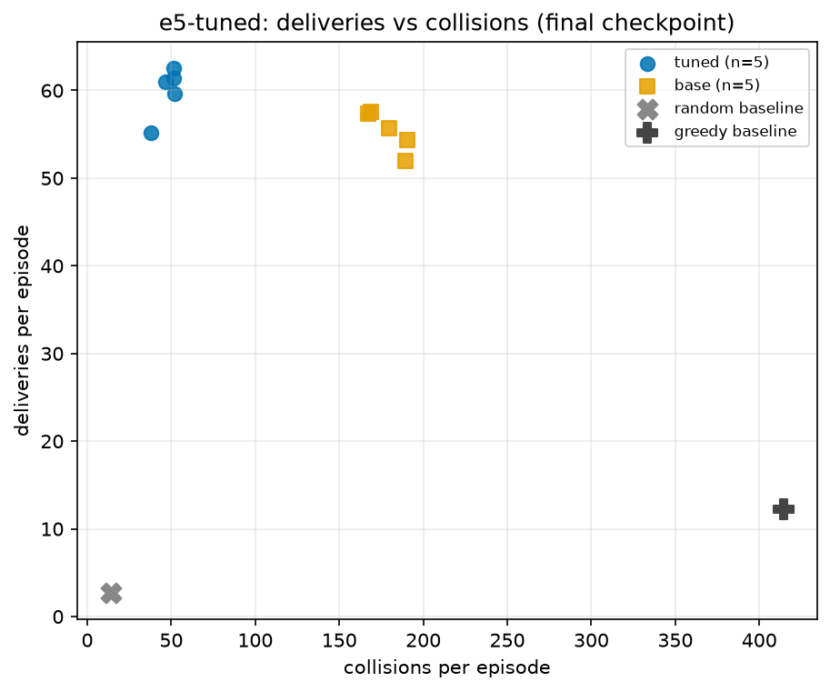
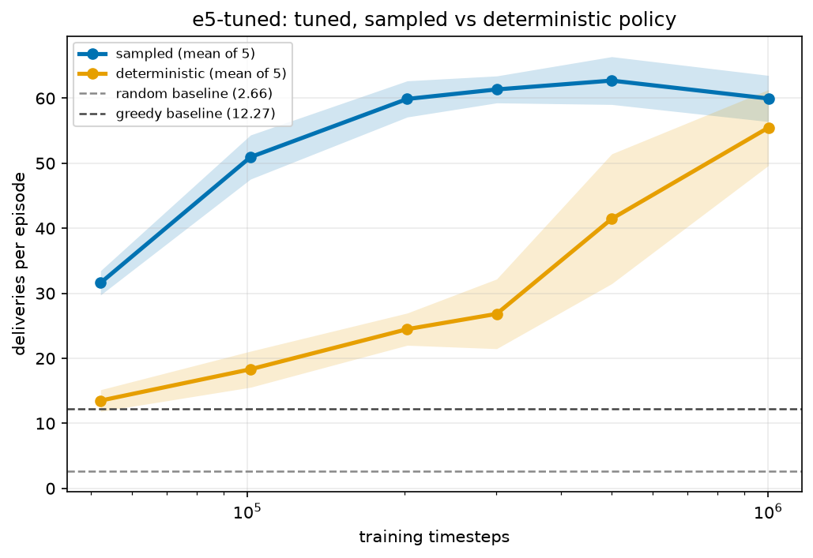
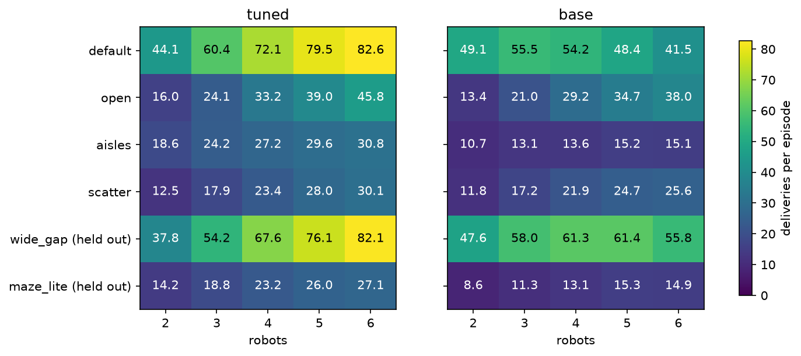

# E5: the tuned model and honest selection

## Question

Does the combined recipe beat the plain PPO, and is it good enough to replace the committed model?

## Setup

- **`tuned`** = `rich_lstm` ([E3](e3-observation-and-memory.md), clear gains) + collision penalty -0.3
  and entropy 0.01 ([E2](e2-hyperparameter-sweep.md), borderline gains). The layout-randomised
  variant was left out ([E4](e4-generalisation.md)).
- Compared with `base`, 5 random training seeds (367, 939, 330, 605, 150), evaluation base seed
  2135743778, 100 episodes.
- **1M steps, not 3M** for both, because the LSTM trains at about 500 steps/s (3M would be about 5
  hours per seed). `base` was already shown to keep improving to 3M, so this is an equal-budget
  comparison.
- **Honest selection.** `select_and_test` chooses the best seed on a random validation block (base
  1567250135) and scores it on a second, disjoint test block (base 844549345) that also avoids the
  experiment block and every training seed. The old committed model and `base` were scored on the
  test block for comparison only.
- **Replacement rule, set in advance:** replace the committed model only if the selected seed beats
  both the old model and the `base` mean by more than the seed spread.

```bash
python -m multi_agent_warehouse.experiment run --name e5-tuned --variants tuned,base --seeds 5 --steps 1000000
python -m multi_agent_warehouse.experiment plot --name e5-tuned
python -m multi_agent_warehouse.experiment generalise --name e5-tuned --variants tuned,base
python -m multi_agent_warehouse.experiment select --name e5-tuned --variant tuned --committed models/ppo_v1_300k.zip
```

## Results

| Variant | Sampled deliveries | Sampled collisions | Deterministic deliveries |
|---|---|---|---|
| tuned | 59.95 ± 2.86 | 47.94 | 55.48 ± 4.70 |
| base | 55.40 ± 2.30 | 179.14 | 11.36 ± 0.52 |

Sampled: tuned minus base = +4.55 (SE 1.64, Δ/SE 2.77), with about 3.7 times fewer collisions.
Deterministic: +44.1, because the tuned policy no longer collapses under arg-max.



`tuned` starts much slower (31.6 at 50k against 51.9), overtakes `base` by about 100k to 200k, and
peaks at 500k (62.7) before ending at 59.95. The late dip is about one seed std and was not
investigated.







### Model selection on the test block

| Model | Validation | Test deliveries | Test collisions |
|---|---|---|---|
| tuned seed 330 (selected) | 62.82 | 63.03 | 50.76 |
| tuned, other four seeds | | 56.74, 62.17, 60.65, 62.59 | 44 to 53 |
| base, 5-seed mean | | 57.16 | about 173 |
| old committed 300k PPO | | 48.69 | 212.08 |

The seed spread is 2.56. The selected seed beats `base` by 5.87 and the old model by 14.34, both more
than the spread, so the rule passed: **the committed model was replaced** (the old one is kept as
`models/ppo_v1_300k.zip`). On the README seeds (1000 to 1099) the shipped model scores **61.99 ± 1.37**
deliveries and **50.90 ± 4.91** collisions.

### Generalisation (extra; not used for selection)

Trained on the default layout only, scored on every layout and 2 to 6 robots:

| Variant | Default layout | Held-out layouts | `maze_lite` |
|---|---|---|---|
| tuned | 67.73 ± 2.62 | 42.71 ± 2.78 | 21.87 ± 3.33 |
| base | 49.74 ± 3.04 | 34.73 ± 1.49 | 12.63 ± 0.63 |



On the default layout the tuned model's total deliveries rise with more robots (44.1 at 2, 82.6 at 6)
but per-robot throughput falls (about 22 to 14). `maze_lite` stays hard.

## Caveats

- **Four changes at once.** E5 does not separate rich observation, LSTM, collision penalty and
  entropy. E3 supports the first two; the last two were only borderline in E2.
- **Equal budget only.** `base` at 3M reaches about 61, so `tuned` at 1M is about level with a fully
  trained `base`. What is shown: better and much safer at equal and small budgets.
- **Selection bias.** The shipped model is the best of five. The other four seeds average about
  60.5, so a typical run is about 60, not 63.
- **Cost.** About 30 times the training time per step, and a 7.2 MB model instead of 146 KB.
- The old model was trained for only 300k steps, so that comparison mixes method with budget.

Full detail: [`FINDINGS.md`](../results/FINDINGS.md), "E5 tuned model".
